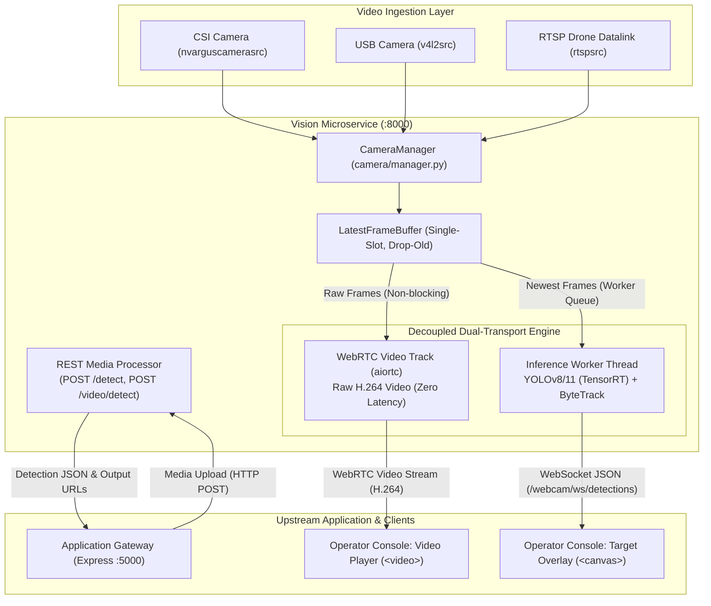

# ASTROX Vision Microservice (Perception & Inference Engine)

FastAPI inference microservice and real-time computer vision subsystem for the **ASTROX UAV Platform**. It executes YOLO neural models—optimized with NVIDIA TensorRT on edge hardware—for single-frame detection, batch video processing, ByteTrack multi-target tracking, live multi-camera ingestion, WebRTC streaming, and system telemetry.

Within the ASTROX ecosystem, this service operates as **Backend 2 (The Vision Engine)**, providing hardware-accelerated computer vision to the upstream [**Drone-Object-Detection-Website-cloud**](https://github.com/maha-vidya/Drone-Object-Detection-Website-cloud.git) application layer and orchestrated via [**astrox-object-detection-cloud**](https://github.com/maha-vidya/astrox-object-detection-cloud.git).

---

## 1. System Integration & Architecture

The Vision Microservice decouples compute-intensive network inference from standard application business logic and uses a **decoupled dual-transport streaming pipeline** to achieve sub-second live video latency:



### Architectural Subsystems:

1. **Multi-Source Ingestion (`camera/`):**
   * Encapsulates hardware-specific GStreamer pipelines for CSI sensors (`nvarguscamerasrc`), USB/V4L2 devices (`v4l2src`), and network RTSP streams (`rtspsrc`).
   * Feeds raw frames into a thread-safe `LatestFrameBuffer` (1-slot capacity, drop-old policy). This design eliminates frame backlogs and ensures downstream consumers always receive the newest capture.

2. **Decoupled Dual-Transport Live Streaming:**
   * **Video Channel (WebRTC):** An `aiortc.VideoStreamTrack` consumes raw frames directly from `LatestFrameBuffer` and streams them as hardware-accelerated H.264 straight to the browser `<video>` element. The video path never calls the detector and never waits on inference, ensuring a continuous, fluid framerate.
   * **Metadata Channel (WebSocket):** An independent worker thread pulls the latest frame, runs `detector.predict_frame()` (YOLO + ByteTrack), and broadcasts bounding box coordinates as JSON over `/webcam/ws/detections`. The client renders these coordinates on a synchronized `<canvas>` overlay directly over the video stream.

3. **REST Media Ingestion & Batch Processing:**
   * Synchronous `/detect` endpoint for single-frame image inspection requested by the Application Gateway.
   * Asynchronous `/video/detect` endpoint for comprehensive frame-by-frame mission video analysis and downloadable video generation.

4. **Upstream Application Gateway Integration:**
   * The Node.js Express Gateway ([`Drone-Object-Detection-Website/backend`](https://github.com/Mahavidyajp/Drone-Object-Detection-Website)) communicates with this service over HTTP loopback (`http://127.0.0.1:8000`) for media analysis and proxies user operations.

---

## 2. Related System Repositories

| Repository | Primary Stack | Architecture Role | Description |
| :--- | :--- | :--- | :--- |
| [**Drone-Object-Detection-Website-cloud**](https://github.com/maha-vidya/Drone-Object-Detection-Website-cloud.git) | React 19, Node.js, Express, MongoDB | Application Layer | Central gateway handling user authentication, telemetry history, and the operator dashboard. |
| [**astrox-cloud-deploy**](https://github.com/maha-vidya/astrox-object-detection-cloud.git) | Docker, Docker Compose, Nginx | Orchestration Hub | Unified cloud deployment templates, reverse proxy definitions, and multi-service networking. |

---

## 3. Platform & Prerequisites

* **Target Hardware:** NVIDIA Jetson Orin Nano / Xavier NX running **JetPack 6 (L4T r36.x)**, or an x86_64 Linux host with NVIDIA CUDA.
* **Python Runtime:** Python 3.10 with JetPack-compatible packages for PyTorch, torchvision, TensorRT, and OpenCV (`cv2`). These must be supplied by NVIDIA or system packages (`apt`); do not overwrite them with generic PyPI builds.
* **GStreamer:** GStreamer 1.0 with standard plugins. CSI sensor capture requires JetPack elements (`nvarguscamerasrc`); V4L2 utilities (`v4l2-utils`) are used for USB/HDMI cameras.
* **Build Headers:** For `aiortc` and PyAV, development headers for FFmpeg, SSL, Opus, and VPX installed via `setup-jetson.sh` are required if building from source.

### Python Environment Configuration (Jetson-Safe)

To prevent pip from overwriting hardware-accelerated JetPack libraries, inherit system site-packages:

```bash
# 1. Run system dependency helper (inspect prior to execution)
./setup-jetson.sh

# 2. Initialize virtual environment inheriting JetPack packages
python3 -m venv --system-site-packages .venv
source .venv/bin/activate
python --version
```

> [!IMPORTANT]
> **Protect JetPack Packages from Pip Shadowing:**  
> Do not execute `pip install -r requirements.txt` blindly on Jetson. Standard PyPI wheels will replace hardware-accelerated `torch`, `torchvision`, `tensorrt`, and `cv2` with non-accelerated builds. Install top-level application packages with `--no-deps`:

```bash
python -m pip install --no-deps \
  "fastapi>=0.110" "uvicorn[standard]>=0.29" \
  "python-multipart>=0.0.9" "pydantic>=2.6" "PyYAML>=6.0" \
  "ultralytics>=8.2" "ultralytics-thop>=2.0" "aiortc>=1.9.0"
```

Verify the environment with these sanity checks:
```bash
python -c "import cv2, numpy, torch, tensorrt, ultralytics; print('Inference imports: OK')"
python -c "import aiortc, av; print('aiortc version:', aiortc.__version__)"
gst-inspect-1.0 v4l2src
gst-inspect-1.0 nvarguscamerasrc
v4l2-ctl --list-devices
```

---

## 4. Model Loading & Configuration

The service does not automatically download weights. You must provide a trained YOLO model or compiled TensorRT engine compatible with your runtime.

By default, startup attempts to load:
```text
models/best.engine
```

* `app.py` reads `MODEL_PATH` once and initializes the `Detector` singleton during module import.
* A missing or incompatible engine prevents the service from booting.
* To specify an alternate model or PyTorch weights (`.pt`), export `MODEL_PATH` before starting:

```bash
export MODEL_PATH=/opt/astrox/models/best.engine
# Or for CPU/local development:
export MODEL_PATH=yolo11n.pt
```

To compile TensorRT engines from PyTorch weights on target hardware:
```bash
yolo export model=best.pt format=engine half=True device=0
```

---

## 5. Camera Configuration (`cameras.yaml`)

Copy the starter configuration template to your working directory:
```bash
cp cameras.yaml.example cameras.yaml
```

The service reads `cameras.yaml` by default (override using `CAMERAS_CONFIG_PATH`). If the file is omitted, the service falls back to auto-discovering USB/HDMI V4L2 cameras.

### Supported Ingestion Sources:
* **USB/HDMI V4L2:** Discovered automatically when `auto_discover_usb: true`; per-device overrides can be specified in `usb_cameras`.
* **CSI Sensors:** Explicit entries under `csi_cameras` specifying `sensor_id`, resolution, and framerate.
* **RTSP / IP Video Streams:** Listed under `rtsp_cameras` specifying target URL, transport protocol (`tcp`/`udp`), and latency buffers.
* **Custom GStreamer Pipelines:** Defined under `custom_cameras` for hardware-specific pipelines.

> [!WARNING]
> **RTSP Credentials:** The `POST /webcam/rtsp/connect` endpoint writes stream credentials to `cameras.yaml` in plaintext. Restrict file permissions (`chmod 600 cameras.yaml`) and do not commit this file to version control.

---

## 6. Execution & Runbook

Once the model and `cameras.yaml` are configured:

```bash
# Launch FastAPI application
uvicorn app:app --host 0.0.0.0 --port 8000
```

* Interactive OpenAPI documentation is accessible at: `http://localhost:8000/docs`.

---

## 7. API Reference Specification

| Endpoint | Method | Response / Payload | Purpose |
| :--- | :--- | :--- | :--- |
| `GET /` | GET | JSON | Service identity and runtime confirmation. |
| `GET /health` | GET | JSON | Health status, configured `MODEL_PATH`, and active compute device. |
| `GET /model/classes` | GET | Array of strings | Class names registered in the loaded YOLO model. |
| `POST /detect` | POST | Multipart Form (`file`) | Single-frame detection; returns detected objects and an annotated output URL. |
| `GET /image/download/{filename}` | GET | File download | Retrieves processed image output from `outputs/`. |
| `POST /video/detect` | POST | Multipart Form (`file`) | Batch video detection and tracking; returns tracking metrics and processed video URL. |
| `GET /video/download/{filename}` | GET | File download | Retrieves processed video file from `outputs/`. |
| `GET /webcam/cameras` | GET | JSON array | Enumerates active, configured, and auto-discovered video sources. |
| `POST /webcam/rtsp/test` | POST | JSON | Probes an external RTSP video link without saving configuration. |
| `POST /webcam/rtsp/connect` | POST | JSON | Tests and persists an RTSP camera stream to `cameras.yaml`. |
| `POST /webcam/session/config` | POST | JSON | Configures mission profile, active camera ID, and recording flags. |
| `POST /webcam/settings` | POST | JSON | Dynamically adjusts inference confidence threshold. |
| `GET /webcam/start` | GET | Query param (`camera_id`) | Starts video capture and continuous inference pipeline. |
| `GET /webcam/stop` | GET | JSON | Stops active camera feed and inference loop. |
| `GET /webcam/status` | GET | JSON | Reports camera pipeline state, active FPS, and target tracking status. |
| `GET /webcam/mission` | GET | JSON | Retrieves telemetry statistics for the ongoing mission session. |
| `POST /webcam/session/clear` | POST | JSON | Resets the active session state and mission logs. |
| `POST /webcam/webrtc/offer` | POST | SDP Offer / Answer | Establishes direct WebRTC media channel using `aiortc` for real-time video streaming. |
| `WS /webcam/ws/detections` | WebSocket | High-frequency JSON | Streams real-time target bounding boxes, classes, and confidence scores. |
| `GET /webcam/recording/{filename}`| GET | File download | Downloads raw mission recording from `recordings/`. |
| `GET /system/stats` | GET | JSON | Reads hardware telemetry (CPU, GPU load, RAM, sysfs thermal readings). |

---

## 8. Video Streaming Architecture

### Direct WebRTC & WebSocket Stream
* `POST /webcam/webrtc/offer`: Establishes peer-to-peer video streaming through `aiortc`.
* `WS /webcam/ws/detections`: Coordinates bounding boxes are transmitted separately as lightweight JSON over WebSocket to minimize video pipeline overhead.
* **ICE Configuration:** Configure STUN/TURN servers via environment variables: `WEBRTC_ICE_URLS` (comma-separated), `WEBRTC_ICE_USERNAME`, and `WEBRTC_ICE_CREDENTIAL`.

### Optional MediaMTX Publishing
The camera manager can optionally publish raw camera streams over RTSP (default: `rtsp://127.0.0.1:8554/cam`; override via `MEDIAMTX_RTSP_URL`). MediaMTX runs independently using `config/mediamtx/mediamtx.yml`. If MediaMTX is offline or GStreamer is unavailable, publishing is disabled while internal YOLO inference continues uninterrupted.

---

## 9. Security & Operational Constraints

* **Network Perimeter:** The API provides **no native authentication**. CORS allows unrestricted origin access. Deploy exclusively within a private virtual network or behind an authenticated reverse proxy (e.g., Nginx with TLS).
* **Concurrency:** The microservice utilizes one active camera source per process. Live video streaming and batch video inference share the singleton detector/tracker instance; concurrent tracking jobs are serialized.
* **Storage Retention:** Ensure adequate storage for `uploads/`, `outputs/`, and `recordings/` (configured via `MISSION_RECORD_DIR`). The service creates these directories automatically but does not implement an automated pruning policy.

---

## 10. Engineering Troubleshooting

| Symptom | Probable Cause | Corrective Action |
| :--- | :--- | :--- |
| **Uvicorn fails during startup** | Missing or corrupted model engine file. | Verify that `MODEL_PATH` points to a valid `.engine` or `.pt` file compatible with the installed TensorRT/PyTorch versions. |
| **Inference fails after `pip install`** | Hardware-accelerated JetPack wheels shadowed. | Reinstall JetPack-provided `torch`, `torchvision`, `tensorrt`, and `cv2`. Always use `--no-deps` for PyPI packages. |
| **`aiortc`/`av` compilation fails** | Missing multimedia build headers. | Execute `./setup-jetson.sh` to install `libav*-dev`, `libssl-dev`, `libopus-dev`, and `libvpx-dev`. |
| **Camera not listed or fails to initialize** | Inaccessible device nodes or missing plugins. | For V4L2: verify permissions on `/dev/video*`. For CSI: check `gst-inspect-1.0 nvarguscamerasrc`. For RTSP: verify network reachability and codec compatibility. |
| **WebRTC connects locally but fails over WAN** | NAT traversal blocking media traffic. | Configure STUN/TURN servers using `WEBRTC_ICE_URLS` and open appropriate UDP port ranges in your firewall. |

---

## 11. Maintainers

* **Platform Architecture:** [Mahavidyajp](https://github.com/Mahavidyajp)
* **Organization:** [AstroX Aerospace](https://www.astrox.co.in)
